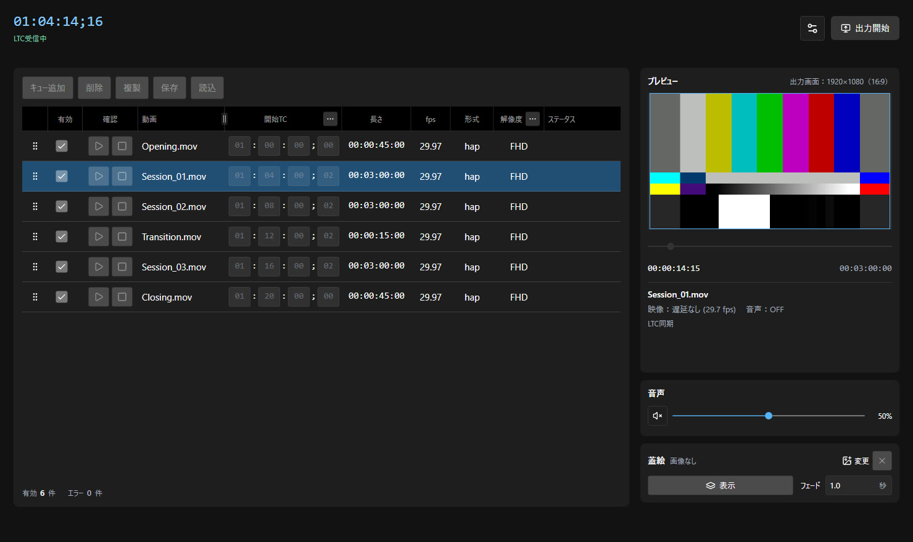

# LTCue

LTCueは、LTC（音声タイムコード）に合わせて動画を再生し、外部ディスプレイへ映像を出力するWindows用ツールです。複数の動画をキューに登録し、動画ごとに再生を開始するタイムコードを指定できます。

MP4/H.264、MOV/HAP・HAP Qに対応しています。
 手動再生、動画の音声プレビュー、蓋絵への切り替えにも対応しています。

## ダウンロード

[Windows版 ZIP · 0.1.0](https://github.com/Nirfuture/LTCue/releases/download/v0.1.0/LTCue-0.1.0-win-x64.zip)

Windows 11 x64対応。現在はプレビュー版です。

## 使い方

- [クイックスタート](docs/guides/QUICKSTART.md)
- [操作リファレンス](docs/guides/USER_GUIDE.md)
- [対応環境・ファイル形式](docs/guides/COMPATIBILITY.md)
- [困ったとき](docs/guides/TROUBLESHOOTING.md)

## 開発・仕様

- [ビルド手順](docs/development/BUILD.md)
- [リリース作成](docs/distribution/RELEASING.md)
- [詳細仕様](docs/development/FINAL_SPEC.md)
- [一括検証](docs/development/VERIFICATION.md)

## ライセンス

個人・商用を問わず利用できます。ただし、現在は開発中のプレビュー版です。動作や特定用途への適合性は保証していません。本番で使用する場合は、使用環境で十分に検証してください。通常の利用にクレジット表示は不要です。

改変・再配布を含む詳しい利用条件は、[ライセンス資料](NOTICE.md)を参照してください。
