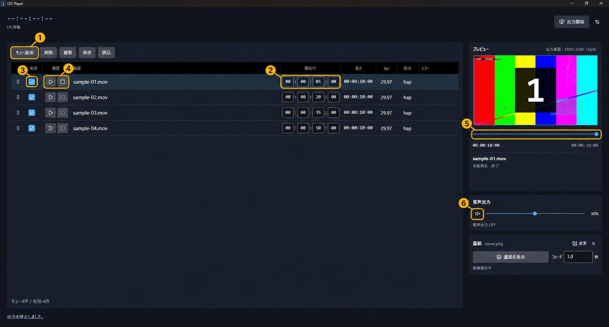
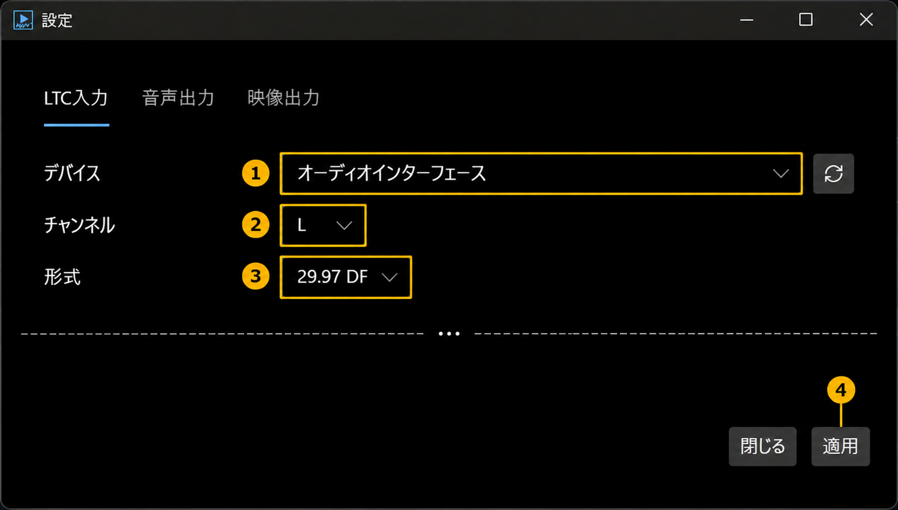
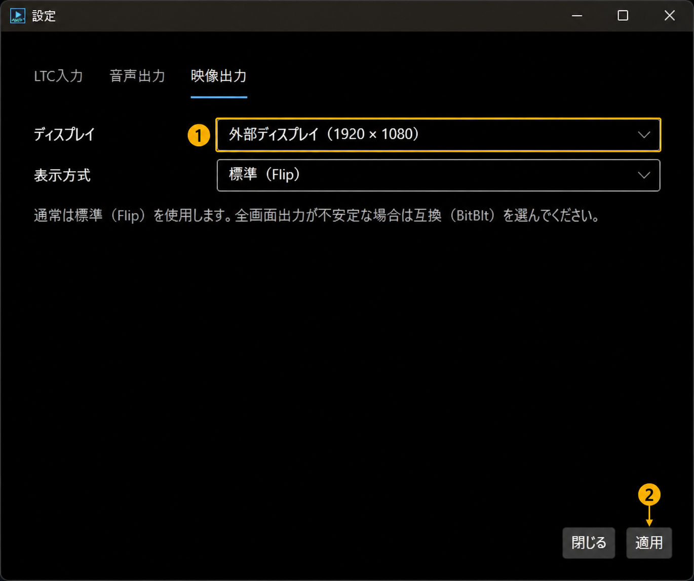
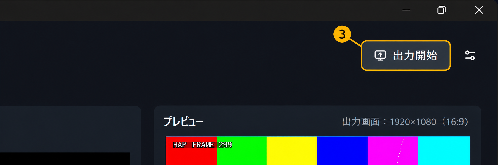

# クイックスタート

## 動作環境

Windows 11 x64に対応しています。以下の導入が必要です。

#### Visual C++ v14 x64ランタイム

1. [Visual C++ v14 x64ランタイム](https://learn.microsoft.com/ja-jp/cpp/windows/latest-supported-vc-redist#latest-supported-redistributable-version)（サポートされている最新の再頒布可能パッケージ バージョン・x64）をダウンロードします
2. インストーラーを実行します。

#### FFmpeg・ffprobe

1. [FFmpeg・ffprobeのWindows用ビルド](https://www.gyan.dev/ffmpeg/builds/)を取得し、展開します。
2. `ffmpeg.exe`と`ffprobe.exe`が入った`bin`フォルダーを開き、アドレスバーのパスをコピーします。
3. Windowsの検索で「環境変数」と入力し、「環境変数を編集」を開きます。
4. ユーザー環境変数の「Path」を選び、「編集」→「新規」の順に押します。コピーしたパスを追加し、「OK」で閉じます。

新しいターミナルで次を実行し、両方のバージョン情報が表示されることを確認します。

```powershell
ffmpeg -version
ffprobe -version
```

すでにLTCueが起動している場合は、終了して起動し直します。

</details>

## 起動

**LTCue 0.1.0-preview.11（Windows x64）をダウンロード（公開準備中）**

<!-- 新リポジトリでの公開後、実行用ZIPへの直リンクを設定する。 -->

ZIPをすべて展開し、直下の`LTCue.exe`を起動します。

## キュー登録と手動再生

<a href="images/quickstart-queue.png"></a>

① **キュー追加**：動画を登録します。一覧へのドラッグ＆ドロップでも追加できます。

② **開始TC**：再生を開始したいタイムコードを入力します。

③ **有効**：再生したい行にチェックを入れます。チェックを外した行は、LTC受信時には再生されません。

④ **確認**：▶で手動再生、Ⅱで一時停止、■で停止します。

⑤ **シークバー**：再生位置を変更します。

⑥ **音声ON/OFF**：音声出力を切り替えます。**起動時はOFFです。** 出力先は設定の「音声出力」で選択します。

> [!WARNING]
> **注意：LTC信号の受信中は、手動再生・シーク操作が無効になります。**

> [!NOTE]
> 対応形式はMP4/H.264、MOV/HAP・HAP Qです。

## LTC同期

LTC入力機器をPCに接続し、画面右上の設定アイコンから「LTC入力」を開きます。

画像の①〜③を設定し、④「適用」を押します。

1. デバイス：LTCを入力する機器
2. チャンネル：LTCを入力するチャンネル（LまたはR）
3. 形式：送信元のフレームレートとDF/NDFに合わせた形式

<a href="images/quickstart-input.png"></a>

同梱のテスト動画を使用する場合は、送信元とアプリのLTC形式を`29.97 DF`に設定します。

設定画面を閉じ、送信元からLTCを送ります。「LTC受信中」が緑色になり、プレビューに動画が表示されることを確認します。

## 外部出力

外部ディスプレイをPCに接続し、設定の「映像出力」を開きます。①出力先ディスプレイを選び、②「適用」を押します。

<a href="images/quickstart-display.png"></a>

設定画面を閉じ、画面右上の③「出力開始」を押します。プレビューと同じ映像が外部ディスプレイに表示されます。

<a href="images/quickstart-output-start.png"></a>

「出力停止」で外部ディスプレイへの出力を停止します。確認画面で「出力を停止」を選びます。外部映像を停止しても、アプリ内の映像・音声の再生は継続します。

## 蓋絵

蓋絵は、動画の代わりに表示する静止画です。操作方法は[操作リファレンスの「蓋絵」](USER_GUIDE.md#cover)を参照してください。

## 保存

「保存」でキュー構成をJSONファイルに保存します。次回は「読込」で開きます。

> [!WARNING]
> **注意：自動保存はありません。終了前に保存してください。**

[操作リファレンス](USER_GUIDE.md) · [トラブルシューティング](TROUBLESHOOTING.md) · [対応環境・動画形式](COMPATIBILITY.md)
