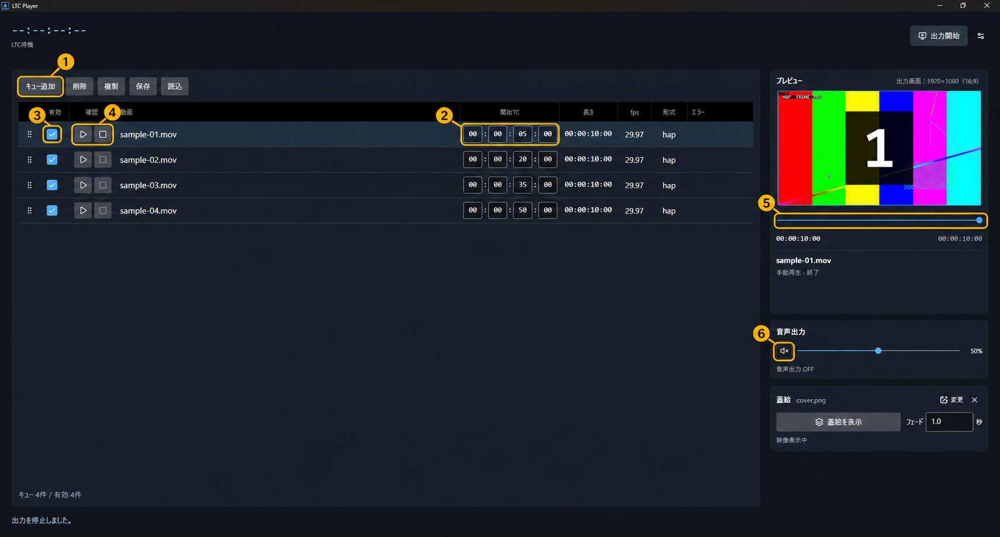
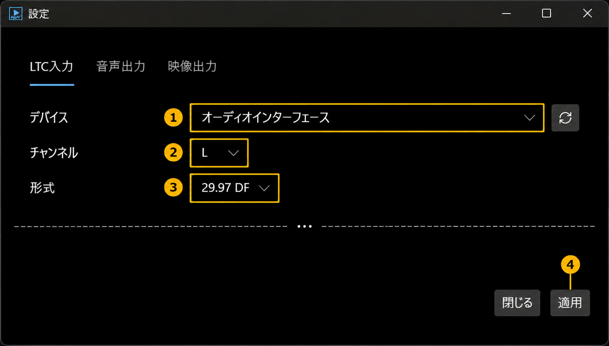
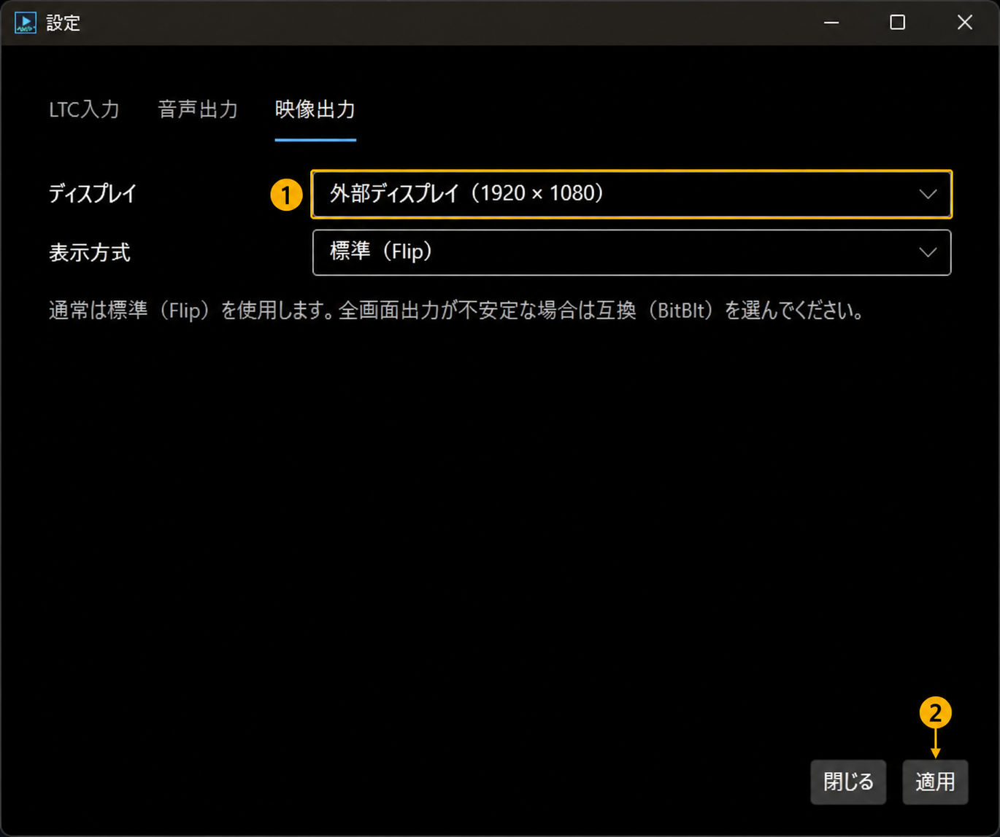
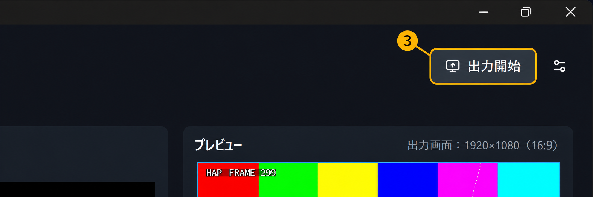
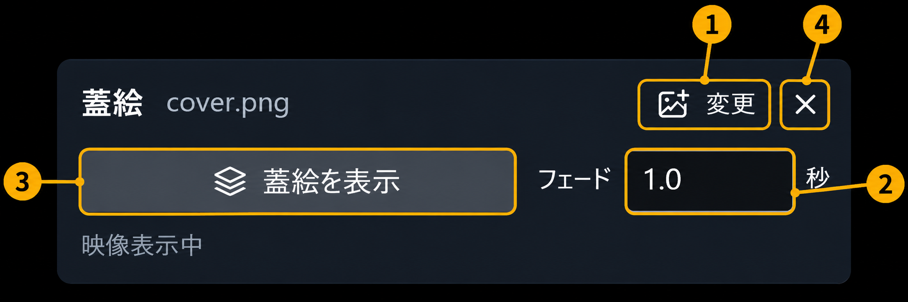

# 操作リファレンス

キューの編集、再生、LTC同期、映像・音声出力、蓋絵、設定と保存について説明します。導入から出力までの手順は[クイックスタート](QUICKSTART.md)を参照してください。

## 目次
- [キュー](#queue)
- [手動再生とプレビュー](#playback)
- [LTC同期](#ltc)
- [外部映像出力](#video)
- [音声出力](#audio)
- [蓋絵](#cover)
- [設定の適用](#settings)
- [保存と読込](#save)

## 画面と同期表示

キュー一覧で動画と開始TCを管理し、プレビューで出力映像を確認します。映像と音声の状態表示は、共通時計に対する内部の位置差を示します。物理ディスプレイの表示時刻や、スピーカーから実際に鳴る時刻を測定する表示ではありません。

| 表示 | 意味 |
|---|---|
| 遅延なし | 内部で測定した位置差が許容範囲内 |
| ○ms遅れ／先行 | 許容範囲を超えるずれが継続 |
| 確認中 | 状態の変化を確認中 |
| 準備中／再同期中 | 再生開始や復旧の準備中 |

### 許容範囲
- 音声：±50ms以内
- 映像：
  - 24fps：±62.5ms（1.5フレームに相当）
  - 25fps：±60ms（1.5フレームに相当）
  - 29.97fps：約±50.05ms（1.5フレームに相当）
  - 30fps以上：±50ms

## キュー

キューは、動画ファイルと再生開始時刻を組み合わせた登録単位です。

### 登録と編集

① **キュー追加**：動画を登録します。一覧へのドラッグ＆ドロップでも追加できます。追加時の開始TCは`00:00:00:00`です。

② **開始TC**：LTC同期で再生を開始したいタイムコードを入力します。時・分・秒・フレームの順に指定します。

③ **有効**：LTC同期で再生したい行にチェックを入れます。チェックを外した行は、LTC受信時には再生されません。

| 操作 | 動作 |
|---|---|
| 削除 | 選択したキューを一覧から削除します。元の動画ファイルは削除しません。 |
| 複製 | 選択したキューを複製します。開始TCは引き継ぎ、有効のチェックは外れた状態になります。 |
| 左端のハンドルをドラッグ | 青い挿入線の位置へ行を移動します。開始TCは変更しません。Escで移動を取り消せます。 |
| ファイル名を右クリック | エクスプローラーで動画の保存場所を開くメニューを表示します。 |

> [!WARNING]
> **外部映像出力中はキューを編集できません。編集する場合は、外部出力を停止してください。**

> [!WARNING]
> **キューに登録される動画はパス参照です。登録後にファイルを移動・名前変更すると読み込めなくなるため、保存場所を決めてから登録してください。**

### 一覧の表示

| 欄 | 内容 |
|---|---|
| 長さ | 動画の再生時間 |
| fps | 動画のフレームレート |
| 形式 | 動画のコーデック |
| エラー | 開始TCの不正、同一開始TCの競合、動画情報の問題、再生区間の重複など。マウスを重ねると全文を確認できます。 |

### 開始TCと再生順

LTC同期での再生順は開始TCで決まります。一覧の並べ替えは表示順だけを変更します。

- 同じ開始TCの行は、同時に有効にできません。開始TCを変更するか、使用しない行のチェックを外します。
- 再生区間が重なる場合は、後から始まるキューに切り替わります。区間の重複は通知されますが、それだけで再生不可にはなりません。
- 後から始まったキューが終了しても、前のキューには戻りません。次のキューが始まるまでは黒画面・無音になります。

例：Aが5〜35秒、Bが20〜30秒の場合、5〜20秒はA、20〜30秒はBを再生します。30秒以降は黒画面になり、Aの残りには戻りません。

> [!NOTE]
> キューは最大1000件です。対応する動画形式はMP4/H.264、MOV/HAP・HAP Qです。HAP alphaには対応していません。[対応環境・動画形式](COMPATIBILITY.md)

## 手動再生とプレビュー

手動再生は、行の④ **確認**で操作します。画面内のプレビューと外部映像出力には、同じ再生映像が表示されます。

### 外部出力を停止している場合

| 操作 | 動作 |
|---|---|
| 行を選択 | 先頭の映像を表示します。自動では再生しません。 |
| ▶ | 選択した動画を再生します。開始TCに関係なく、先頭から確認できます。 |
| 再生中のⅡ | 一時停止します。次の▶で、その位置から再開します。 |
| ■ | 映像を保持して停止します。次の▶では先頭から再生します。 |
| 終端後の▶ | 先頭から再生します。終端では最後の映像を保持します。 |
| ⑤シークバー | クリックやドラッグで再生位置を変更します。矢印キー、Home、Endでも操作できます。 |

有効のチェックを外した行も、外部出力を停止している間は手動で確認できます。

### 外部出力中の場合

LTC未受信時、または信号が途絶して補間が終了した後は、有効なキューの▶で先頭から手動再生できます。■で映像を保持して停止します。外部出力中はシークできません。

LTCの受信が再開すると、現在のタイムコードに同期します。

> [!WARNING]
> **LTC信号の受信中と補間中は、手動再生・シーク操作が無効になります。LTC入力エラー中も、新たに手動再生を開始できません。**

### プレビューの表示

プレビューは、蓋絵や黒帯を含めた出力画面全体を表示します。青い枠が出力範囲を示し、上部に出力画面の解像度と縦横比を表示します。

映像の縦横比は維持され、余白は黒帯になります。プレビューは縮小表示のため、外部画面と解像度や表示タイミングが完全には一致しません。

## LTC同期

設定の「LTC入力」で入力機器と形式を選びます。①〜③を設定し、④「適用」を押します。

### 入力設定

① **デバイス**：LTCを入力する機器を選択します。横の円形矢印で機器一覧を再読み込みします。

② **チャンネル**：LTCを接続した側のLまたはRを選択します。

③ **形式**：送信元のフレームレートとDF/NDFに合わせます。24、25、29.97 NDF、29.97 DF、30に対応しています。DFの場合、画面上部のタイムコードはフレームの区切りが`;`になります。

| 項目 | 動作・初期値 |
|---|---|
| 補正（フレーム） | LTCに対する再生位置をフレーム単位で調整します。正の値で先の位置、負の値で前の位置を再生します。初期値は0です。 |
| 未受信時の補間（秒） | LTCが途切れた後も再生を進める時間です。初期値は0.1秒です。 |
| 再同期閾値（フレーム） | 受信したTCと現在の再生時計のずれを、再同期として扱う基準です。初期値は2フレームです。 |

### 入力レベル

「入力ピーク」で信号の有無とレベルを確認できます。dBFSは0に近いほど大きな入力です。「上限付近」が続く場合は、送信元や入力機器のレベルを確認してください。

入力ピークとLTCの受信状態は別の表示です。ピークが動いていてもLTCを受信できない場合は、チャンネル・形式・送信元の信号を確認します。

> [!NOTE]
> 入力ピークは適用中の機器・チャンネルを表示します。選択を変更しただけでは測定先は変わりません。

### 信号が途絶した場合

| 状態 | 映像・音声の動作 |
|---|---|
| LTC受信中 | 現在のタイムコードに同期して再生します。 |
| LTC補間中 | 設定した補間時間の範囲で再生を継続します。 |
| 補間終了後 | 最後の映像を保持し、音声を停止します。手動再生が可能になります。 |
| 受信再開・TCジャンプ | 現在のタイムコードに合わせて再生位置を更新します。 |
| LTC入力エラー | 映像を保持し、音声を停止します。接続と設定を確認します。 |

入力機器が切断された場合は、同じ機器IDへの再接続を試みます。別の入力機器には自動で切り替わりません。逆方向のLTCには対応していません。

## 外部映像出力

外部ディスプレイをPCに接続し、設定の「映像出力」を開きます。

① **ディスプレイ**：出力先の画面を選択します。

② **適用**：設定を反映します。その後、設定画面を閉じてメイン画面に戻ります。

③ **出力開始**：画面右上のボタンで、外部画面への映像出力を開始します。

### 停止と取消

「出力停止」を押し、確認画面で「出力を停止」を選びます。「出力を続ける」を選ぶと、そのまま出力を継続します。確認画面を開いている間も出力は続きます。

出力開始・停止では、再生位置と蓋絵のフェードはリセットされません。外部出力を停止した後も、LTC同期と手動再生は継続します。

> [!WARNING]
> **外部映像を停止しても音声は止まりません。音声も停止する場合は、⑥スピーカーボタンをOFFにしてください。**

### 表示方式

| 方式 | 用途 |
|---|---|
| 標準（Flip） | 通常使用する方式です。 |
| 互換（BitBlt） | 標準方式で全画面出力が不安定な場合に使用します。負荷や表示遅延が変わる場合があります。 |

方式や出力先を変更する場合は、外部出力を停止します。

保存した出力先が未接続の場合、その選択を保持します。別画面には自動で切り替わりません。再接続するか、出力先を選び直してください。出力先が未接続でも、LTC入力と音声出力の設定は適用できます。

出力先の切断・表示構成変更で外部出力が停止した場合は、接続と設定を確認して「出力開始」で再開します。別画面へ自動で出力し直しません。接続変更に伴う一時的な音切れは発生する場合があります。

## 音声出力

メイン画面の⑥ **スピーカーボタン**でON/OFFを切り替え、隣のスライダーで音量を調整します。手動再生とLTC同期のどちらでも音声を出力できます。

| 操作・状態 | 動作 |
|---|---|
| スピーカーON | 現在の再生位置の音声を出力します。 |
| スピーカーOFF | 音声出力を停止します。 |
| 音量0 | 無音になります。音声出力はONのままです。 |
| 一時停止・停止・終端・キュー外 | 無音になります。 |
| 蓋絵を表示 | 動画の音声は継続します。 |
| アプリ起動時 | 毎回OFFです。前回の音量と出力先は保持します。 |

### 出力先の変更

スピーカーボタンをOFFにしてから、設定の「音声出力」で機器を選択し、「適用」を押します。円形矢印で機器一覧を再読み込みできます。

「システム既定」を選んだ場合も、ONにした時点の機器を使用します。ONの間にWindowsの既定機器を変更しても、出力先は変わりません。

機器が切断された場合は、接続を確認してOFF→ONで再試行してください。別の機器には自動で音声を出力しません。

> [!NOTE]
> 動画音声はAAC・PCM系、48kHzステレオに対応しています。音声のない動画や非対応の音声形式では、映像のみ再生します。

## 蓋絵

蓋絵は、動画の代わりに表示する静止画です。異常発生時に手動で映像を隠したり、待機中にイベントロゴを表示したりする際に使用します。

① **変更**：外部出力を停止しているとき、「変更」を押すことで、PNG/JPEG画像を登録することができます。

② **フェード**：切り替えにかける秒数を指定します。範囲は0〜60秒、初期値は1秒です。0秒にすると即時に切り替わります。

③ **蓋絵を表示／映像に戻す**：静止画と動画を切り替えます。フェード中に切り替えた場合は、その時点の表示から反対方向へフェードします。

④ **×**：登録した画像を解除します。解除は外部出力を停止している間に行えます。

画像が未登録の場合や読み込めない場合は、黒画面を使用します。画像の縦横比は維持され、余白と透過部分は黒になります。

蓋絵の表示中も動画と音声は進みます。解除すると、その時点の映像に戻ります。起動時は蓋絵の表示がOFFになります。

## 設定の適用

画面右上の設定アイコンから、LTC入力・音声出力・映像出力を設定します。

| 操作・表示 | 動作 |
|---|---|
| 適用 | 変更を反映します。設定画面は閉じません。 |
| 閉じる | 設定画面を閉じます。未適用の変更は破棄し、適用済みの設定は保持します。 |
| 黄色の項目とタブの● | 未適用の変更があります。 |
| 円形矢印 | LTC入力・音声出力の機器一覧を再読み込みします。 |
| 適用ボタンが無効 | 適用する変更がない場合などに無効になります。 |

外部映像出力中は、LTC入力と映像出力の設定を変更できません。音声出力先は、音声をOFFにすると変更できます。

設定の保存に失敗した場合は、以前の設定を保持し、エラーを表示します。適用失敗後に、手動再生が自動で再開することはありません。

## 保存と読込

「保存」でキュー構成をJSONファイルに保存し、「読込」で開きます。

| 保存先 | 内容 |
|---|---|
| 保存したJSON | 動画のパス、開始TC、有効・無効、一覧の表示順、LTC形式 |
| アプリの設定 | LTC入力、映像・音声の出力先、表示方式、音量、蓋絵の画像パスとフェード時間 |

動画や蓋絵の画像そのものは保存データに含まれません。別のPCへ移す場合は、使用する素材も一緒に保管・移動してください。

読込時には動画の情報を再確認します。保存時のパスに動画がない場合は、一覧にエラーを表示します。

> [!WARNING]
> **自動保存はありません。終了前に保存してください。次回は「読込」で保存したJSONを開きます。**

通常起動時は同梱テスト動画4本を読み込みます。前回のキュー構成は自動で復元しません。音声出力ON・蓋絵表示ON・外部映像出力ONも復元しません。

### 同梱テスト素材

| 動画 | 開始TC（29.97 DF） |
|---|---|
| 1 | `00:00:05;00` |
| 2 | `00:00:20;00` |
| 3 | `00:00:35;00` |
| 4 | `00:00:50;00` |

`TestMedia/LTC_29.97DF_from-zero.wav`はPC内でLTC入力を確認するための信号です。使用する場合は、ループバック機能や仮想オーディオケーブルで音声入力へ戻し、アプリのLTC入力にその機器を選択します。同梱動画の音声は確認用トーンで、LTC信号とは別です。

[クイックスタート](QUICKSTART.md) · [トラブルシューティング](TROUBLESHOOTING.md) · [対応環境・動画形式](COMPATIBILITY.md)
