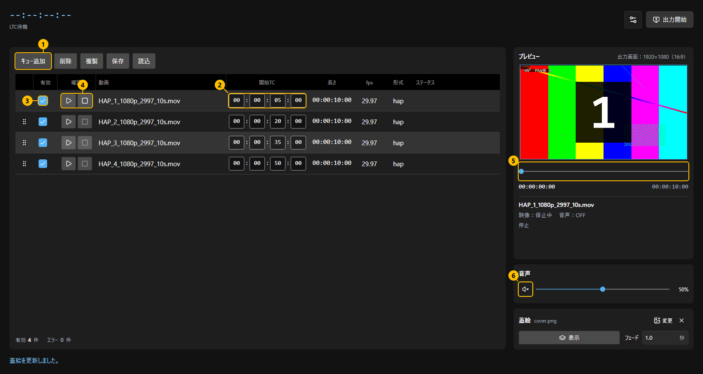
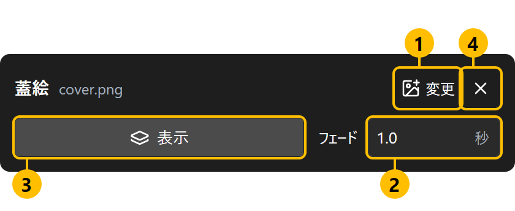

# 操作リファレンス

キューの編集、再生、LTC同期、映像・音声出力、蓋絵、設定と保存について説明します。導入から出力までの手順は[クイックスタート](QUICKSTART.md)を参照してください。

## 目次

- [キュー](#queue)
- [手動再生とプレビュー](#playback)
- [LTC同期](#ltc)
- [外部映像出力](#video)
- [音声出力](#audio)
- [蓋絵](#cover)
- [設定の適用](#settings)
- [保存と読込](#save)

## キュー

キューは、動画ファイルと再生開始時刻を組み合わせた登録単位です。

### 登録と編集

① **キュー追加**：動画を登録します。一覧へのドラッグ＆ドロップでも追加できます。追加時の開始TCは`00:00:00:00`です。

② **開始TC**：LTC同期で再生を開始したい時刻を、時・分・秒・フレームの順に入力します。EnterまたはTC欄の外へのフォーカス移動で確定し、Escで取り消します。LTC受信開始時は未確定の入力を取り消します。

③ **有効**：LTC同期で再生したい行にチェックを入れます。チェックを外した行は同期再生されません。エラーがある行も、チェックは自動で外れません。

LTC未受信時や、信号が途絶して補間が終了した後は、外部出力中でも編集できます。LTC受信・再同期・補間中、入力エラー中は編集できません。ただし、表示順の並べ替えは同期中も可能です。

### 選択・削除・並べ替え

通常クリックで1件、Ctrlクリックで選択を追加・解除、Shiftクリックで範囲選択できます。行を選択しても動画は読み込まず、表示中の映像は変わりません。

| 操作 | 動作 |
|---|---|
| 削除 | 選択したキューをまとめて一覧から削除します。元の動画ファイルは削除しません。 |
| 複製 | 1件だけ選択したときに複製できます。開始TCは引き継ぎ、有効のチェックは外れた状態になります。 |
| 左端のハンドルをドラッグ | 操作した1行を青い挿入線の位置へ移動します。開始TCは変更しません。複数行の一括移動はできません。Escで取り消せます。 |
| ファイル名を右クリック | エクスプローラーで動画の保存場所を開くメニューを表示します。 |

表示中のキューを削除すると、停止中・一時停止中やLTC途絶後の保持映像も含め、黒画面・無音になります。外部出力と蓋絵は維持します。それ以外のキューを削除しても、現在の再生・保持映像は変わりません。削除後に別のキューを自動再生することはありません。

### 一覧の表示と列幅

| 欄 | 内容 |
|---|---|
| 長さ | 動画の再生時間 |
| fps | 動画のフレームレート |
| 形式 | 動画のコーデック |
| ステータス | 素材エラー、開始TCの不正・重複、再生区間の重複など。マウスを重ねると全文を確認できます。 |

左下の「有効 X 件」はチェックの入ったキュー数、「エラー Y 件」は無効な行も含むエラーのあるキュー数です。有効なキューにエラーがある場合は両方に数えます。

「動画」列の見出し右端を左右にドラッグすると、「動画」と「ステータス」の幅配分を調整できます。出力・LTC同期中も操作できます。アプリを再起動すると初期の幅に戻ります。

### 開始TCと再生順

LTC同期での再生順は開始TCで決まります。一覧の並べ替えは表示順だけを変更します。

- 同じ開始TCの有効行は、すべて同期対象外になります。開始TCを変更するか、使用しない行のチェックを外すと再判定されます。
- 再生区間が重なる場合は、後から始まるキューに切り替わります。区間の重複は通知されますが、それだけで再生不可にはなりません。
- 後から始まったキューが終了しても、前のキューには戻りません。次のキューが始まるまでは黒画面・無音になります。

例：Aが5〜35秒、Bが20〜30秒の場合、5〜20秒はA、20〜30秒はBを再生します。30秒以降は黒画面になり、Aの残りには戻りません。

### 素材エラーと復旧

動画は登録したパスから読み込みます。ファイルの移動・名前変更・削除などで読めなくなると、「ステータス」欄にエラーを表示し、そのキューを同期対象から除外します。

次の動画の準備に失敗しても、現在の正常な動画は継続します。再生中の動画が読み込めなくなった場合は黒画面・無音となり、次の正常なキューを待ちます。蓋絵がONなら蓋絵を維持します。

動画を元の場所へ戻すと自動で確認し、読めればエラーを解除します。LTCがその動画の再生区間内なら途中位置から復帰します。手動で停止・一時停止した動画は、ファイルが戻っただけでは再生しません。

復旧の確認には時間がかかる場合があります。破損した動画を修復した場合は、保存し直すか、行の▶で再試行してください。

キューは最大1000件です。対応形式は[対応環境・ファイル形式](COMPATIBILITY.md)を参照してください。

## 手動再生とプレビュー

### 再生操作

各行の④ **確認**で、その行の動画を操作します。複数選択中も、ボタンを押した行が対象です。外部出力中も操作方法は同じで、プレビューと外部画面には同じ映像が表示されます。

| 操作 | 動作 |
|---|---|
| 行の▶ | 動画を読み込み、開始TCに関係なく先頭から再生します。 |
| 再生中のⅡ | 一時停止します。次の▶で、その位置から再開します。 |
| ■ | 停止し、再生位置を先頭に戻して先頭フレームを表示します。次の▶では先頭から再生します。 |
| 終端後の▶ | 先頭から再生します。終端では最後の映像を保持します。 |
| ⑤シークバー | クリックやドラッグで再生位置を変更します。矢印キー、Home、Endでも操作できます。再生中は再生、一時停止中は一時停止を維持します。 |

有効のチェックを外した行や、開始TCが不正・重複している行も、動画を読み込めれば手動再生できます。読み込みに時間がかかる場合は、活動表示に対象ファイルと準備状況を表示します。

シークバーは表示中の動画を操作します。別の行を選択しても操作対象は変わりません。蓋絵を表示している間も、その下の動画を操作します。

### LTC同期中の制限

LTC受信・再同期・補間中は手動再生・停止・シークを操作できません。LTC入力エラー中も、新たに手動再生を開始できません。

未受信時や補間終了後は、行の▶で手動再生できます。LTC途絶後の保持映像は直接シークできないため、先に▶で手動再生へ切り替えます。LTCの受信が再開すると、現在のタイムコードに同期します。

### プレビューの見方

プレビューは、蓋絵や黒帯を含む出力画面全体を表示します。青い枠が出力範囲を示し、上部に出力画面の解像度と縦横比、下部に再生位置・動画名・映像と音声の状態を表示します。

映像の縦横比は維持され、余白は黒帯になります。プレビューは縮小表示のため、外部画面と解像度や表示タイミングが完全には一致しません。同期状態の表示は[LTC同期の「同期状態の表示」](#sync-status)を参照してください。

## LTC同期

設定の「LTC入力」で入力機器と形式を選びます。①〜③を設定し、④「適用」を押します。

### 入力設定

① **デバイス**：LTCを入力する機器を選択します。横の円形矢印で機器一覧を再読み込みします。

② **チャンネル**：LTCを接続した側のLまたはRを選択します。

③ **形式**：送信元のフレームレートとDF/NDFに合わせます。24、25、29.97 NDF、29.97 DF、30に対応しています。DFの場合、画面上部のタイムコードはフレームの区切りが`;`になります。

| 項目 | 動作・初期値 |
|---|---|
| 補正（フレーム） | LTCに対する再生位置をフレーム単位で調整します。正の値で先の位置、負の値で前の位置を再生します。初期値は0です。 |
| 補間時間（秒） | LTCが途切れた後も再生を進める時間です。初期値は0.1秒です。 |
| 再同期閾値（フレーム） | 受信したTCと現在の再生時計のずれを、再同期として扱う基準です。初期値は2フレームです。 |

### 入力レベル

「入力ピーク」で信号の有無とレベルを確認できます。dBFSは0に近いほど大きな入力です。「入力過大」が続く場合は、送信元や入力機器のレベルを確認してください。

入力ピークとLTCの受信状態は別の表示です。ピークが動いていてもLTCを受信できない場合は、チャンネル・形式・送信元の信号を確認します。

> [!NOTE]
> 入力ピークは適用中の機器・チャンネルを表示します。選択を変更しただけでは測定先は変わりません。

### 信号が途絶した場合

| 状態 | 映像・音声の動作 |
|---|---|
| LTC受信中 | 現在のタイムコードに同期して再生します。 |
| LTC補間中 | 設定した補間時間の範囲で再生を継続します。 |
| 補間終了後 | 最後の映像を保持し、音声を停止します。手動再生が可能になります。 |
| 受信再開・TCジャンプ | 現在のタイムコードに合わせて再生位置を更新します。 |
| LTC入力エラー | 映像を保持し、音声を停止します。接続と設定を確認します。 |

入力機器が切断された場合は、同じ機器IDへの再接続を試みます。別の入力機器には自動で切り替わりません。逆方向のLTCには対応していません。

### 入力設定を変更したとき

外部出力中もLTC設定を変更できます。補間時間・再同期閾値は次のLTC受信から適用します。補正を変更すると、同期中は新しい位置へ再同期し、未受信で映像を保持している場合は受信再開時に反映します。

入力機器・チャンネル・形式を変更すると、同期中の映像は黒画面・無音になります。外部出力と蓋絵は維持し、手動再生は停止しません。適用に失敗した場合は以前の入力への復旧を試み、復旧できなければ入力エラーを表示します。

### 同期状態の表示

プレビュー下部の映像・音声の状態表示で確認できます。LTC受信に同期しているときだけ、LTCに対する内部の位置差を表示します。物理ディスプレイやスピーカーでの遅延を測定した値ではありません。

| 表示 | 意味 |
|---|---|
| 再生中 | LTC同期によらない手動再生中 |
| 遅延なし | LTC受信に同期中で、内部の位置差が許容範囲内 |
| ○ms遅れ／先行 | LTC受信に同期中で、許容範囲を超えるずれが継続 |
| 補間中 | LTCの受信が途切れ、内部時計で補間中 |
| 入力待ち | LTCを待ち、同期映像を保持中 |
| 確認中 | 状態の変化を確認中 |
| 準備中／再同期中 | 再生開始や復旧の準備中 |

「遅延なし」の許容範囲は、音声が±50ms、映像が次の範囲です。

| 映像のfps | 許容範囲 |
|---|---|
| 24 | ±62.5ms |
| 25 | ±60ms |
| 29.97 | 約±50.05ms |
| 30以上 | ±50ms |

### 同梱テスト素材

| 動画 | 開始TC（29.97 DF） |
|---|---|
| 1 | `00:00:05;00` |
| 2 | `00:00:20;00` |
| 3 | `00:00:35;00` |
| 4 | `00:00:50;00` |

`TestMedia/LTC_29.97DF_from-zero.wav`はPC内でLTC入力を確認するための信号です。使用する場合は、ループバック機能や仮想オーディオケーブルで音声入力へ戻し、アプリのLTC入力にその機器を選択します。同梱動画の音声は確認用トーンで、LTC信号とは別です。

## 外部映像出力

外部ディスプレイをPCに接続し、設定の「映像出力」を開きます。

① **ディスプレイ**：出力先の画面を選択します。

② **適用**：設定を反映します。その後、設定画面を閉じてメイン画面に戻ります。

③ **出力開始**：画面右上のボタンで、外部画面への映像出力を開始します。

### 停止と取消

「出力停止」を押し、確認画面で「停止する」を選びます。「出力を続ける」を選ぶと、そのまま出力を継続します。確認画面を開いている間も出力は続きます。

出力開始・停止では、再生位置と蓋絵のフェードはリセットされません。外部出力を停止した後も、LTC同期と手動再生は継続します。

> [!WARNING]
> **外部映像を停止しても音声は止まりません。音声も停止する場合は、⑥スピーカーボタンをOFFにしてください。**

### 表示方式

| 方式 | 用途 |
|---|---|
| 標準 | 通常使用する方式です。 |
| 互換 | 標準方式で全画面出力が不安定な場合に使用します。負荷や表示遅延が変わる場合があります。 |

方式や出力先を変更する場合は、外部出力を停止します。

出力先が未接続の場合は、再接続するか出力先を選び直してください。接続中の画面が切断されたり表示構成が変わったりすると、外部出力は停止します。接続と設定を確認し、「出力開始」で再開します。別の画面へ自動では切り替わりません。

## 音声出力

メイン画面の⑥ **スピーカーボタン**でON/OFFを切り替え、隣のスライダーで音量を調整します。手動再生とLTC同期のどちらでも音声を出力できます。

| 操作・状態 | 動作 |
|---|---|
| スピーカーON | 現在の再生位置の音声を出力します。 |
| スピーカーOFF | 音声出力を停止します。 |
| 音量0 | 無音になります。音声出力はONのままです。 |
| 一時停止・停止・終端・キュー外 | 無音になります。 |
| 蓋絵を表示 | 動画の音声は継続します。 |
| アプリ起動時 | 毎回OFFです。前回の音量と出力先は保持します。 |

### 出力先の変更

スピーカーボタンをOFFにしてから、設定の「音声出力」で機器を選択し、「適用」を押します。円形矢印で機器一覧を再読み込みできます。

「システム既定」を選んだ場合も、ONにした時点の機器を使用します。ONの間にWindowsの既定機器を変更しても、出力先は変わりません。

機器が切断された場合は、接続を確認してOFF→ONで再試行してください。別の機器には自動で音声を出力しません。

> [!NOTE]
> 動画音声はAAC・PCM系、48kHzステレオに対応しています。音声のない動画や非対応の音声形式では、映像のみ再生します。

## 蓋絵

蓋絵は、動画の代わりに表示する静止画です。異常発生時に手動で映像を隠したり、待機中にイベントロゴを表示したりする際に使用します。

画像の登録・変更・解除は、外部出力中・LTC同期中にも行えます。

① **変更**：PNG/JPEG画像を登録・差し替えます。

② **フェード**：切り替えにかける秒数を指定します。範囲は0〜60秒、初期値は1秒です。0秒にすると即時に切り替わります。

③ **表示／非表示**：静止画と動画を切り替えます。フェード中に切り替えた場合は、その時点の表示から反対方向へフェードします。

④ **×**：登録した画像を解除して黒を使用します。

画像が未登録の場合や起動時に読み込めない場合は、黒画面を使用します。画像の縦横比は維持され、余白と透過部分は黒になります。

画像の変更は準備完了後に反映し、失敗・取消時は以前の画像を維持します。画像を変更しても表示／非表示と進行中のフェードは維持します。画像間の追加フェードは行いません。

蓋絵の表示中も動画と音声は進みます。「非表示」を押すと、その時点の映像に戻ります。起動時は蓋絵の表示がOFFになります。

## 設定の適用

画面右上の設定アイコンから、LTC入力・音声出力・映像出力を設定します。

| 操作・表示 | 動作 |
|---|---|
| 適用 | 変更を反映します。設定画面は閉じません。 |
| 閉じる | 未適用の変更を破棄して設定画面を閉じます。適用済みの設定は保持します。 |
| 黄色の項目とタブの● | 未適用の変更があります。 |
| 円形矢印 | 機器一覧を再読み込みします。 |

変更できない項目はグレーアウトします。マウスを重ねると理由を確認できます。設定の保存に失敗した場合は、以前の設定を保持してエラーを表示します。

## 保存と読込

「保存」でキュー構成をJSONファイルに保存し、「読込」で開きます。

| 操作 | 利用できる条件 |
|---|---|
| 保存 | キューが1件以上あり、LTC受信・再同期・補間中でないこと。全件無効や、素材・開始TCのエラーがある場合も保存できます。 |
| 読込 | LTC未受信時、または信号が途絶して補間が終了した後。入力エラー中は読み込めません。 |

どちらも外部出力中に操作できます。読込は現在のキュー一覧を置き換え、表示中の動画を解除して黒画面・無音にします。外部出力と蓋絵は維持します。取消・失敗時は、保存先の既存ファイルや現在の一覧を維持します。

| 保存先 | 内容 |
|---|---|
| 保存したJSON | 動画のパス、開始TC、有効・無効、一覧の表示順、LTC形式 |
| アプリの設定 | LTC入力、映像・音声の出力先、表示方式、音量、蓋絵の画像パスとフェード時間 |

動画や蓋絵の画像そのものは保存データに含まれません。別のPCへ移す場合は、使用する素材も一緒に保管・移動してください。読込時には動画の情報を再確認し、参照できない素材は一覧にエラーを表示します。

> [!WARNING]
> **自動保存はありません。終了前に保存してください。次回は「読込」で保存したJSONを開きます。**

通常起動時は同梱テスト動画4本を読み込み、前回のキュー構成は自動で復元しません。音声出力・蓋絵表示・外部映像出力も、起動時はOFFです。

[クイックスタート](QUICKSTART.md) · [トラブルシューティング](TROUBLESHOOTING.md) · [対応環境・ファイル形式](COMPATIBILITY.md)
