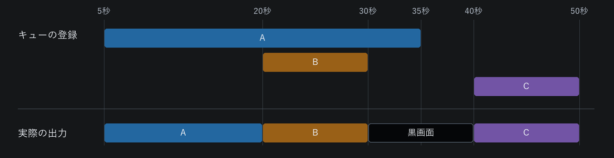
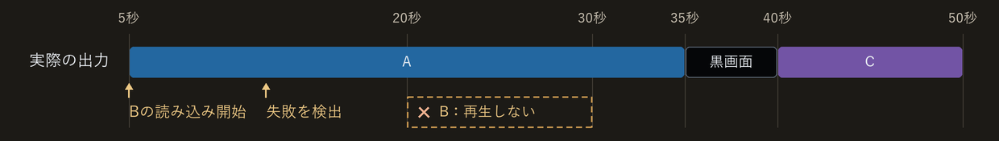
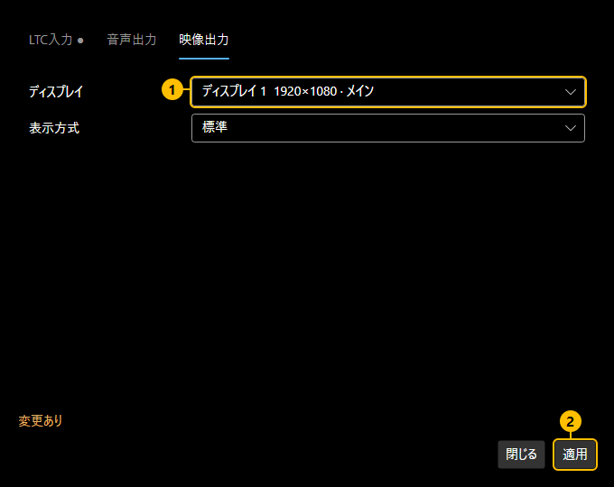
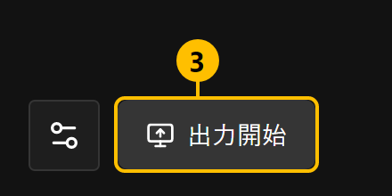

# 操作リファレンス

キューの編集、再生、LTC同期、映像・音声出力、蓋絵、設定と保存について説明します。導入から出力までの手順は[クイックスタート](QUICKSTART.md)を参照してください。

## 目次

- [設定](#settings)
- [キュー](#queue)
- [保存と読込](#save)
- [手動再生とプレビュー](#playback)
- [LTC同期](#ltc)
- [映像出力](#video)
- [音声出力](#audio)
- [蓋絵](#cover)
- [付録：テスト素材](#test-media)

## 設定

画面右上の設定アイコンから、LTC入力・音声出力・映像出力を設定します。

| 操作・表示 | 動作 |
|---|---|
| 適用 | 変更を反映します。設定画面は閉じません。 |
| 閉じる | 未適用の変更を破棄して設定画面を閉じます。適用済みの設定は変わりません。 |
| 黄色の項目とタブの● | 未適用の変更があります。 |
| 円形矢印 | 機器一覧を再読み込みします。 |

変更できない項目はグレーアウトされます。マウスを重ねると理由を確認できます。設定の保存に失敗した場合は、以前の設定のままエラーが表示されます。

## キュー

キューは、動画ファイルと再生開始時刻を組み合わせた登録単位です。

### 登録

① **キュー追加**：動画を登録します。一覧へのドラッグ＆ドロップでも追加できます。追加時の開始TCは、初期設定では`00:00:00:00`です。キューは最大1000件です。対応形式は[対応環境・ファイル形式](COMPATIBILITY.md)を参照してください。

② **開始TC**：LTC同期で再生を開始したい時刻を、時・分・秒・フレームの順に入力します。EnterまたはTC欄の外へのフォーカス移動で確定し、Escで取り消します。LTC受信が始まると、未確定の入力は取り消されます。

③ **有効**：LTC同期で再生したい行にチェックを入れます。チェックを外した行は同期再生されません。

LTC受信・再同期・補間中、入力エラー中は、キューの追加・削除・複製、開始TC・有効の変更はできません。

### 一括入力

「開始TC」見出し右の「⋯」から開きます。変更前・変更後を確認し、「反映」を押してください。対象は全キュー、または選択キューから選べます。

| 操作 | 内容 |
|---|---|
| CSVから入力 | 開始TCを1列に並べたCSVを選び、一覧の表示順に割り当てます。 |
| テキストから入力 | 開始TCを1行ずつ入力し、一覧の表示順に割り当てます。 |
| 間隔で配置 | 先頭の開始TCと、動画が終わってから次が始まるまでの間隔を指定します。0秒なら連続配置です。 |
| 追加時の開始TC | 新規追加を「00:00:00:00」か「既存キューの後ろ」に設定します。 |

CSV・テキストは対象と同じ件数のTCを指定してください。CSVはUTF-8で保存し、見出しを付ける場合は「開始TC」とします。不正な値や件数の不一致がある場合は反映できません。

「既存キューの後ろ」は、無効なキューも含む最も遅い終了時刻に、指定間隔を足した位置です。追加時の設定は次回起動時も引き継がれます。長さ不明・開始TC不正などで自動計算できない場合は、対象のキューを確認してください。

### 編集

通常クリックで1件、Ctrlクリックで選択を追加・解除、Shiftクリックで範囲選択できます。行を選択しても、表示中の映像は変わりません。

| 操作 | 動作 |
|---|---|
| 削除 | 選択したキューを一覧から削除します。元の動画ファイルは削除しません。 |
| 複製 | 選択したキューを複製します。開始TCは同じで、有効のチェックは外れた状態になります。 |
| 移動 | 行左側のハンドルをドラッグして表示順を変更できます。開始TCは変わりません。Escで取り消せます。 |
| ファイル名を右クリック | 動画の保存場所をエクスプローラーで開きます。 |

表示中のキューを削除すると黒画面・無音になります。蓋絵を表示している場合は、蓋絵がそのまま表示されます。別のキューが自動で再生されることはありません。

### 項目

| 欄 | 内容 |
|---|---|
| 長さ | 動画の再生時間 |
| fps | 動画のフレームレート |
| 形式 | 動画のコーデック |
| 解像度 | 素材の解像度をプリセット名または幅×高さで表示 |
| ステータス | エラーや警告を確認できます。マウスを重ねると全文が表示されます。 |

左下には、有効なキューの件数と、そのうちエラーのあるキューの件数が表示されます。警告はエラー件数に含まれません。

「動画」列の見出し右端を左右にドラッグすると、「動画」と「ステータス」の幅配分を調整できます。

「解像度」見出し右の「⋯」で表示方法とプリセットを設定できます。初期値はHD（1280×720）、FHD（1920×1080）、UHD（3840×2160）で、寸法が一致しない素材は「未登録」、解像度未取得の素材は空欄です。プリセットの追加・編集・削除は「適用」で保存され、次回起動時も引き継がれます。「形式」セルにマウスを重ねるとコンテナ（MP4／MOV）を、「解像度」セルでは幅×高さの実寸を確認できます。

### ファイルの読み込み

動画は登録時の保存場所から読み込まれます。ファイルの移動・名前変更・削除などで読み込めなくなると、そのキューは再生できません。

正常な動画を元の場所へ戻すと自動で再確認され、読み込みに成功すればエラーが解除されます。手動で停止・一時停止した動画は、自動では再生されません。復旧の確認には時間がかかる場合があります。

## 保存と読込

「保存」でキュー構成をJSONファイルに保存し、「読込」で開きます。動画の参照先、開始TC、有効・無効、一覧の表示順、LTC形式が保存されます。

> [!IMPORTANT]
> **動画の参照先は絶対パスで保存されます。動画ファイル自体は保存ファイルに含まれません。**

| 操作 | 利用できる条件 |
|---|---|
| 保存 | キューが1件以上あり、LTC受信・再同期・補間中でないこと。全件無効や、素材・開始TCのエラーがある場合も保存できます。 |
| 読込 | LTC未受信時、または信号が途絶して補間が終了した後。入力エラー中は読み込めません。 |

読み込むと現在のキュー一覧が置き換わり、映像・音声は停止します。蓋絵を表示していない場合は黒画面になります。参照できない動画は、一覧の「ステータス」欄にエラーが表示されます。

保存の取消・失敗時は既存の保存ファイル、読込の取消・失敗時は現在のキュー一覧がそのまま残ります。

> [!WARNING]
> **自動保存はありません。終了前に保存してください。次回は「読込」で保存したJSONを開きます。**

通常起動時は同梱テスト動画4本が読み込まれます。前回のキュー構成は自動では復元されません。音声出力・蓋絵表示・外部映像出力も、起動時はOFFです。

## 手動再生とプレビュー

### 再生操作

各行の④ **確認**で、その行の動画を操作します。

| 操作 | 動作 |
|---|---|
| ▶ | 動画を先頭から再生します。 |
| Ⅱ | 一時停止します。次の▶で、その位置から再開します。 |
| ■ | 停止して先頭フレームに戻ります。次の▶では先頭から再生されます。 |
| ⑤シークバー | クリックやドラッグで再生位置を変更します。矢印キー、Home、Endでも操作できます。 |

有効のチェックを外した行や、開始TCが不正・重複している行も、動画を読み込めれば手動再生は可能です。

### 操作の制限

LTC受信・再同期・補間中は手動再生・停止・シークを操作できません。LTC入力エラー中も、新たに手動再生を開始できません。

### プレビュー

プレビューには、外部出力先と同じ映像が表示されます。青い枠が出力範囲です。上部で解像度と縦横比、下部で再生位置・動画名・映像と音声の状態を確認できます。

映像の縦横比は維持され、余白は黒帯になります。プレビューは縮小表示のため、外部画面と解像度や表示タイミングが完全には一致しません。映像・音声の状態は[LTC同期の「再生状態」](#sync-status)を参照してください。

## LTC同期

設定の「LTC入力」で入力機器と形式を選びます。①〜③を設定し、④「適用」を押します。

### 入力設定

① **デバイス**：LTCを入力する機器を選択します。横の円形矢印で機器一覧を再読み込みできます。アプリ起動中に機器を接続し直した場合などはいちど円形矢印を押下して再読み込みしてください。

② **チャンネル**：LTCを入力するチャンネル（LまたはR）を選択します。

③ **形式**：送信元のフレームレートとDF/NDFに合わせます。24、25、29.97 NDF、29.97 DF、30に対応しています。DFの場合、画面上部のタイムコードはフレームの区切りが`;`になります。

| 項目 | 動作・初期値 |
|---|---|
| 補正（フレーム） | LTCに対する再生位置をフレーム単位で調整します。正の値で先の位置、負の値で前の位置を再生します。初期値は0です。 |
| 補間時間（秒） | LTCが途切れた後も再生を進める時間です。初期値は0.1秒です。 |
| 再同期閾値（フレーム） | 受信したTCと現在の再生時計のずれを、再同期として扱う基準です。初期値は2フレームです。 |

### 入力レベル

「入力ピーク」で信号の有無とレベルを確認できます。dBFSは0に近いほど大きな入力です。「入力過大」が続く場合は、送信元や入力機器のレベルを確認してください。

ピークが動いていてもLTCを受信できない場合は、チャンネル・形式・送信元の信号を確認してください。

> [!NOTE]
> 入力ピークは適用中の機器・チャンネルからの入力値を表示します。選択を変更しただけでは測定先は変わりません。機器変更後は「適用」を押下してください。

### 再生順

LTC同期では、各キューの開始TCになると再生が始まります。一覧を並べ替えても再生順は変わりません。

- 開始TCが不正なキューは同期再生されません。
- 開始TCに重複がある場合は、「有効」にチェックが入っていてもすべて同期再生対象外になります。開始TCを変更するか、使用しない行のチェックを外してください。
- 再生区間が重なる場合は、後から始まるキューへ切り替わります。区間の重複は警告として表示されますが、再生できます。

次の図は、Aが5〜35秒、Bが20〜30秒、Cが40〜50秒の例です。

20秒でAからBへ切り替わります。Bが終わる30秒になってもAには戻らず、Cが始まる40秒まで黒画面・無音になります。

> **読み込みエラーが起きた場合**
>
> LTC同期中は、現在のキューの再生開始に合わせて、次のキューの再生準備も始まります。
>
> 次のBを準備している間に、ファイルの紛失・破損などで読み込めないことが分かった場合、Bはスキップされます。AはBの開始時刻を過ぎても35秒まで再生され、その後はCが始まる40秒まで黒画面・無音になります。
>
> 
>
> 再生中の動画で読み込みに失敗した場合は、次の正常なキューまで黒画面・無音になります。前の動画には戻りません。
>
> ファイルの紛失・破損の解消が確認できた場合、復旧時のLTCがその動画の再生区間内なら、途中位置から同期再生されます。

### 受信状態

画面左上のタイムコードの下に、LTCの受信状態が表示されます。

| 表示 | 動作 |
|---|---|
| LTC待機 | LTCの受信待ちです。 |
| LTC受信中 | 受信したタイムコードに同期して再生されます。 |
| LTC補間中 | 信号が途絶した後、設定した補間時間だけ再生が続きます。 |
| LTC未受信 | 補間終了時のフレームが保持され、音声は停止します。 |
| LTC入力エラー | エラー発生直前のフレームが保持され、音声は停止します。入力機器と設定を確認してください。 |

受信が再開したりTCがジャンプしたりすると、そのタイムコードに合わせて再生されます。

入力機器が切断されると、同じ機器への再接続が試みられます。別の入力機器には自動で切り替わりません。逆方向のLTCには対応していません。

> [!WARNING]
> **本番中はLTCの入力機器・チャンネル・形式を変更しないでください。**
>
> 同期中に変更すると、同期再生がいったん停止し、黒画面・無音になります。変更後の設定でLTCを受信すると再開されます。蓋絵の表示や手動再生は継続します。
>
> 変更に失敗した場合は元の入力設定に戻り、戻せなかった場合は「入力エラー」が表示されます。

### 再生状態

プレビュー下部に、映像と音声それぞれの再生状態が表示されます。LTC受信に同期しているときだけ、LTCに対する内部の位置差が表示されます。物理ディスプレイやスピーカーでの遅延を測定した値ではありません。

同期中もシークバーは映像の位置に追従しますが、操作はできません。映像状態の横に表示されるfpsは、アプリが1秒間に更新した映像フレーム数を示します。実際にディスプレイへ表示されたフレーム数とは異なります。素材fpsの90%未満が2秒続くと数値が赤くなります。

| 表示 | 意味 |
|---|---|
| 再生中 | LTC同期によらない手動再生中 |
| 遅延なし | LTC同期中で、内部の位置差が許容範囲内 |
| ○ms遅れ／先行 | LTC同期中で、許容範囲を超えるずれが継続 |
| 補間中／入力待ち | LTCの受信状態に伴う表示です。上の「受信状態」を参照してください。 |
| 確認中 | 状態の変化を確認中 |
| 準備中／再同期中 | 再生開始や復旧の準備中 |

「遅延なし」として表示される遅延の許容範囲は、音声が±50ms、映像が次の範囲です。

| 映像のfps | 許容範囲 |
|---|---|
| 24 | ±62.5ms（1.5フレーム相当） |
| 25 | ±60ms（1.5フレーム相当） |
| 29.97 | 約±50.05ms（1.5フレーム相当） |
| 30以上 | ±50ms |

## 映像出力

外部ディスプレイをPCに接続し、設定の「映像出力」を開きます。

① **ディスプレイ**：出力先の画面を選択します。

② **適用**：設定を反映します。その後、設定画面を閉じてメイン画面に戻ります。

③ **出力開始／出力停止**：外部画面への映像出力を開始・停止します。

外部出力を開始・停止しても、動画・音声の再生と蓋絵のフェードは続きます。

### 表示方式

| 方式 | 用途 |
|---|---|
| 標準 | 通常使用する方式です。 |
| 互換 | 標準方式で全画面出力が不安定な場合に使用します。負荷や表示遅延が変わる場合があります。 |

出力先・表示方式を変更するには、先に「出力停止」を押してください。

ディスプレイの切断や画面構成の変更により、映像出力は自動で停止します。再開するには、設定で出力先を確認し、「出力開始」を押してください。

## 音声出力

メイン画面の⑥ **スピーカーボタン**でON/OFFを切り替え、隣のスライダーで音量を調整します。手動再生とLTC同期のどちらでも音声を出力できます。

音声だけにエラーが発生した場合も、映像の再生は続きます。

| 操作・状態 | 動作 |
|---|---|
| スピーカーON | 現在の再生位置の音声を出力します。 |
| スピーカーOFF | 音声出力を停止します。 |
| 一時停止・停止・終端・キュー外 | 無音になります。 |
| アプリ起動時 | 毎回OFFです。音量と出力先の設定は保存されます。 |

### 出力先の変更

スピーカーボタンをOFFにしてから、設定の「音声出力」で機器を選択し、「適用」を押します。円形矢印で機器一覧を再読み込みできます。

「システム既定」を選んだ場合も、ONにした時点の機器から音声が出力されます。ONの間にWindowsの既定機器を変更しても、出力先は変わりません。

機器が切断された場合は、接続を確認してOFF→ONで再試行してください。出力先は自動では切り替わりません。

> [!NOTE]
> 動画音声はAAC・PCM系、48kHzステレオに対応しています。音声のない動画や非対応の音声形式では、映像のみ再生されます。

## 蓋絵

蓋絵は、動画の代わりに表示する静止画です。異常発生時に手動で映像を隠したり、待機中にイベントロゴを表示したりする際に使用します。

① **変更**：PNG/JPEG画像を登録・差し替えます。

② **フェード**：切り替えにかける秒数を指定します。範囲は0〜60秒、初期値は1秒です。0秒にすると即時に切り替わります。

③ **表示／非表示**：静止画と動画を切り替えます。フェード中に切り替えた場合は、その時点の表示から反対方向へフェードします。

④ **×**：登録した画像を解除します。蓋絵を表示中の場合は黒画面になります。

画像が未登録の場合や起動時に読み込めない場合は、黒画面になります。画像の縦横比は維持され、余白と透過部分は黒になります。

画像の変更は準備完了後に反映されます。失敗・取消時は以前の画像のままです。表示中に変更すると、追加のフェードなしで新しい画像に切り替わります。進行中のフェードはそのまま続きます。

蓋絵の表示中も動画と音声は進みます。「非表示」を押すと、その時点の映像に戻ります。起動時は蓋絵の表示がOFFになります。

## 付録：テスト素材

| 動画 | 開始TC（29.97 DF） |
|---|---|
| 1 | `00:00:05;00` |
| 2 | `00:00:20;00` |
| 3 | `00:00:35;00` |
| 4 | `00:00:50;00` |

`TestMedia/LTC_29.97DF_from-zero.wav`はPC内でLTC入力を確認するための信号です。使用する場合は、ループバック機能や仮想オーディオケーブルで音声入力へ戻し、アプリのLTC入力にその機器を選択します。同梱動画の音声は確認用トーンで、LTC信号とは別です。

[クイックスタート](QUICKSTART.md) · [トラブルシューティング](TROUBLESHOOTING.md) · [対応環境・ファイル形式](COMPATIBILITY.md)
