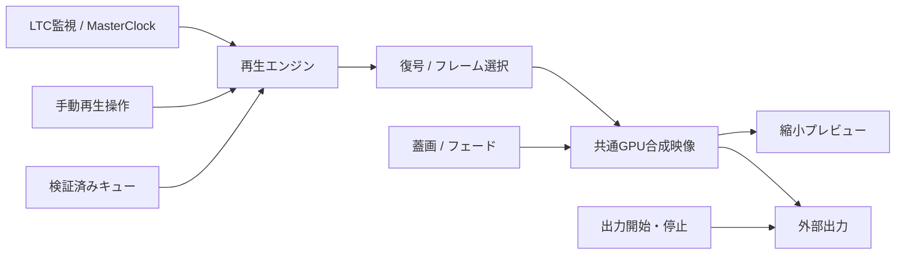

> 履歴資料：策定時の提案・開発指示です。現行の技術構成・操作仕様・完了状況は[現行実装仕様](../FINAL_SPEC.md)と[一括検証](../VERIFICATION.md)を参照してください。

# LTC Player 要件定義書 v0.5（再設計案）

2026-11-10 音声方針更新：[音声出力要件v0.6](LTC_Player_Audio_Requirements_v0.6.md)と[実装計画](LTC_Player_Audio_Plan_v0.6.md)を採用。以下の確認用音声・外部映像開始時の音声停止・本番音声対象外の記述は新要件で置き換える。製品コードへの反映は未完了。

作成日: 2026-11-10 / 状態: 実装前の提出案

対応計画: LTC_Player_Implementation_Plan_v0.5_Draft.md

## 1. 目的と仕様の扱い

LTCに基づく映像生成、画面内の縮小プレビュー、外部ディスプレイへの出力を整理する。外部出力の開始・停止で再生処理を切り替えず、同じ合成済み映像を表示先へ渡す。

本書はこのチャットで合意した設計を基にした提案であり、現行実装の完成を示さない。採用後は本書に明記した差分をFINAL_SPECより優先する。旧要件、リリース記録、検証結果は履歴として残す。

### 確定した方向

- 共通の映像生成処理を1系統にする。
- 出力ボタンは外部出力の有無を管理し、再生位置・同期・フェードを切り替えない。
- プレビューと外部出力は同じ内容を示す。表示タイミングの厳密な一致は求めない。
- プレビューを縮小して負荷を抑える。
- 再生仕様を先に確定・検証し、その後に詳細UIを詰める。
- 必要なら大きな改修を行うが、成立済みの部品と検証資産は再利用する。

### 本案で置く初期値・運用案

「解像度1/4」は総画素数1/4、すなわち幅・高さ各1/2と解釈する。1080p基準では最大960×540相当。プレビュー更新上限はまず30fpsとする。これらは性能測定後に確定する。幅・高さを各1/4とする意味なら総画素数は1/16となるため、区別して扱う。

手動停止・終端は最終映像保持、出力中のプレビュー音声は無音とする案を採用する。これらの操作仕様は段階0で確認し、実装前に確定する。

## 2. 対象と対象外

対象: Windows 11 x64、Avalonia、.NET 10、WASAPI/libltc、H.264/HAP/HAP Q、D3D11、単一外部出力、キュー編集、JSON、確認用音声、蓋画とフェード。

対象外: ネットワーク配信、本番音声、Genlock、複数独立タイムライン、動画間クロスフェード、新コーデック追加。物理ディスプレイの同時発光や無瞬断の出力ウィンドウ生成は保証範囲に含めない。

## 3. 映像生成と表示の構成

### 映像内容の一致

- キュー、PTS、アスペクト比、黒帯、蓋画、フェード量は共通の映像生成結果から決める。
- プレビューは既に合成した映像を縮小する。別デコーダー・別スケジューラー・別のフェード時計を持たない。
- フレームに世代、連番、CueId、PTS、合成時刻を付け、どの結果を各表示先が採用したか検証できるようにする。
- 縮小補間や表示時刻の違いによる画素差は許容する。同一フレームIDについて、基準の縮小画像との一致を検証する。
- 外部出力がない場合も映像生成を継続する。出力オン・オフで時計、デコーダー、解析キャッシュ、蓋画状態を初期化しない。

### 出力画面の基準

- 合成キャンバスは選択した出力設定の寸法・縦横比とする。プレビューにはその全体像を表示する。
- 出力開始時に接続・寸法・位置を検証する。開始ボタンによる全素材の再解析は行わない。
- ディスプレイ変更は別の設定操作として処理する。必要なキャンバス再構成は外部出力停止中に行う。
- 接続先消失時に別の画面へ自動変更しない。保存済みの妥当な寸法でプレビューを継続し、再接続を案内する。寸法が未確定なら既定1920×1080の仮想キャンバスを使う。

## 4. 状態と操作

再生状態と外部出力状態を別に管理する。出力の準備中・停止中にも映像生成は続ける。

| 系統 | 主な状態 |
|---|---|
| 再生 | Empty / Preparing / ManualPlaying / Paused / Holding / LtcFollowing / Error |
| LTC | WAITING / LOCKED / FREEWHEEL / LOST / RESYNC / ERROR |
| 外部出力 | Off / Starting / On / ConfirmingStop / Stopping / Faulted |

### LTC優先

- LTC監視はアプリ寿命で1組。外部出力操作によって入力を開き直さない。
- LOCKED/FREEWHEEL/RESYNCではLTCを優先し、手動再生・シークは拒否する。
- LOSTでは最後に表示した映像を保持する。手動操作を行った場合は手動再生へ移る。
- WAITINGでは手動再生を許可する。ERRORでは新しい手動再生を許可しない現行の出力保護方針を維持する。
- 受信復帰・ジャンプでは世代を更新し、古いロード・復旧・表示要求を採用しない。
- キュー選択は開始TCの後発優先。重複警告、同時刻競合禁止、終了後に前キューへ戻らない規則を維持する。

### 手動再生（統一案）

- 行の選択だけでは再生を始めず、準備後の先頭フレームを共通映像へ採用する。外部出力中の行選択は映像を変更しない。
- 行の再生操作は共通エンジンへ送る。他のキューの再生処理を残さない。
- 一時停止は現在位置保持。停止・終端も映像保持とし、再度の再生で停止時・終端からの再スタート規則を明示する。停止後の▶は先頭から、単なる一時停止後の▶は現在位置から再開する。
- 停止ボタンを位置0・黒へ戻す現行の手動プレビュー動作は、本案では変更する。黒に切り替える操作は蓋画未登録の黒を使用する。
- 出力中は現行同様に未受信・LOSTでの有効キュー先頭再生と停止保持だけを許可する。停止中のみ一時停止・任意シークを許可する。操作制限はエンジン側でも検証する。
- 外部出力停止中の任意シーク位置を保持したまま出力を開始できる。

### 外部出力

- 開始は共通GPU映像への表示先の追加。最初に使える最新の合成済み映像を提示する。
- 開始に失敗しても共通エンジンとプレビューを継続し、出力状態だけを失敗として通知する。
- 停止は表示先の解除。確認の取消中も映像生成と出力を継続する。
- 出力停止時に再生位置の復元・プレビューの再ロード・音声の自動再開を行わない。
- 出力開始・停止、Esc、出力ウィンドウの閉じる操作、アプリ終了の確認を共通化する。
- 出力障害は表示先を切り離す。共通エンジン／GPUデバイス自体の障害は別扱いとし、影響範囲を通知する。
- 出力中のキュー編集・入出力設定変更は禁止する運用を維持する。

### 確認用音声

- 手動確認中のみAAC/PCMをWindows既定音声出力へ出す。LTC同期中は無音。
- 外部出力開始時は確認音声を停止・ミュートするが、映像の時計と位置をリセットしない。
- 音声再生位置を映像時計へ反映する方式を使う場合、音声停止時も連続する時計へ切り替える。出力停止で音声を勝手に再開しない。
- 音量・ミュートは確認用音声のみに作用する。

## 5. 性能・資源・障害

- 共通合成は本番基準解像度を維持する。プレビュー縮小によって元映像の復号負荷まで1/4になるとは扱わない。
- プレビューは表示領域の実ピクセル寸法とキャンバス幅・高さの1/2を上限にGPU縮小する。アスペクト比を保ち、必要なら画面内で拡大表示する。
- 最新フレーム1枚を保留上限とし、遅いプレビューは古い更新を落とす。プレビューの完了待ちを本番提示の条件にしない。
- 通常経路で全画素CPU読戻し・CPU合成・別GPUへの往復転送を行わない。
- 現在と次キュー／復旧用を合わせ、復号ストリームは最大2つ。バッファ・キャッシュ・ログキューは有界とする。
- ログI/Oは再生ループと分離し、書込み失敗・遅延で再生を止めない。
- 旧読込をキャンセルし、後続の選択・LTC再受信・終了を妨げない。途中失敗時も資源解放と状態解除を保証する。
- 同じGPUデバイスの喪失では両表示先が影響を受け得る。プレビュー単独障害で本番を止めない条件と、共通障害の範囲を区別する。
- Flip/BitBltは外部表示先の設定として維持する。標準Flip全画面停止の根本原因は別課題として継続する。

## 6. 蓋画・フェード

- PNG/JPEG、比率保持、余白・透明部分は黒。未登録・起動時読込失敗は黒。
- 共通GPU合成で1回だけ適用する。元映像と合成結果を分け、再描画で合成を累積させない。
- 0〜60秒、既定1秒。0秒は即時。途中反転は現在の濃さから指定時間で遷移する。
- フェード開始時に秒数を取り込む。遷移中の秒数編集は次の切替から有効にし、進行中のフェードを飛ばさない。
- 出力開始・停止で進行中のフェードを再開始しない。蓋画中も裏で再生を継続する。
- 画像パス・フェード時間は保存、オン状態は起動時リセット。登録・解除はメイン画面、出力停止中のみ許可する。
- 画像欠損が入力機器など無関係な設定変更を妨げない。

## 7. UI要件と後続の仕様詰め

### ちらつき

- 進捗表示の出現・消失でプレビュー矩形の位置・寸法を変えない。
- 短時間の準備は進捗表示を抑制する案とし、初期値は300ms後の表示。表示した場合の最低継続時間は200msを候補とする。操作完了を待たせるための遅延には使わない。
- 進捗は予約済みの固定領域に表示する。ネイティブHWNDへのオーバーレイは前提にしない。
- ロード／シーク準備中は旧フレームを保持し、成功時に採用する。明示的な黒区間・初期状態・障害表示以外で黒クリアを挟まない。
- 原因は未確定。レイアウト変化、Black呼出し、HWND／swap chain再作成、リサイズ、遮蔽復帰を計測して切り分ける。

### シークバー

- プレビュー矩形の直下に隣接配置する。名前・時刻・進捗表示を間へ挟まない。
- LTC同期時と外部出力中は操作不可。位置情報を残す場合は、無効なバーまたは読取専用の進行表示として一貫させる。最終表現はUI検討で確定する。
- ホバー・単なるフォーカスで追従を止めず、ドラッグ／キーボード操作中だけ更新競合を避ける。

### フェード秒数のUI

- 切替操作と時間設定を見分けられる配置にする。「切替時間」など意味の明確なラベルと秒の単位を付ける。
- 0秒は「即時」と分かる表示。直接入力・キーボード操作・不正値の回復を保証する。
- 候補: 「即時／0.5／1／2秒」のプリセット＋任意秒数入力。スライダー単独は採用せず、細かい値を確定できる入力を残す。
- 小さい上下ボタンの改善、プリセットの種類、配置、入力確定の方法は再生仕様成立後のUI段階で実機比較し確定する。
- 時間入力中に毎打鍵で保存せず、確定時に検証・保存する。

## 8. 既存資産の扱い

| 資産 | 方針 |
|---|---|
| MasterClock、LTC復号・WASAPI入力 | 原則再利用。世代と時計境界の試験を維持 |
| CueScheduler、TC変換、上演JSON | 原則再利用。UIデータとの結合と一括検証を整理 |
| MediaDecoder、HAP索引・Snappy | 再利用。キャンセルと解析キャッシュの所有権を整える |
| ProgramPlaybackの遅延復旧 | アルゴリズムを維持し、セッション・表示先依存を抽出 |
| GPU HAP描画・蓋画シェーダー | 画素比較を維持して共通キャンバスへ移す |
| PreviewPlayer／本番への位置引継ぎ | 役割を共通エンジンへ吸収。不要となる二重経路を段階廃止 |
| UI、ドラッグ、レスポンシブ | 利用可能な部分を維持。再生仕様に関係する部分を更新 |
| 自動試験・実機記録 | 再利用。変わる要件だけ期待値を更新し、旧試験の失敗は隠さない |

## 9. 受入条件

| ID | 条件 |
|---|---|
| A01 | 出力オン・オフで再生セッションID、復号世代、時計、キュー位置、フェード開始時刻が不要に変わらない |
| A02 | 同一フレームIDの共通合成結果とプレビュー縮小結果が、定めた補間誤差内で一致する |
| A03 | 出力開始・失敗・停止でプレビュー再ロードや意図しない黒クリアが発生しない |
| A04 | LTC継続・喪失・復帰・前後ジャンプ、後発キュー優先、黒区間が維持される |
| A05 | 手動再生・一時停止・停止・終端・シークと確認用音声の動作が状態表に従う |
| A06 | 出力停止確認中も出力継続。取消・承認・終了・連打が競合しない |
| A07 | プレビューが遅延・遮蔽・リサイズしても本番ループへ待機を追加せず、保留は1枚以下 |
| A08 | 読込中の別選択・LTC復帰・終了で旧要求がキャンセルされ、資源が残らない |
| A09 | 障害注入で状態解除・資源解放・再試行可能性を確認する |
| A10 | 進捗の出現・消失でプレビューの位置・寸法とHWND世代が変わらず、短時間の表示点滅を抑制できる |
| A11 | シークバーが映像直下にあり、フェード入力が狭い画面とキーボードでも操作可能 |
| A12 | JSON・設定互換、ログ上限、単一起動、配布とライセンス境界を維持する |

性能の数値目標は現行測定を基に段階1で確定する。物理同期精度・他の環境・2時間以上の耐久は独立した検証として報告する。
